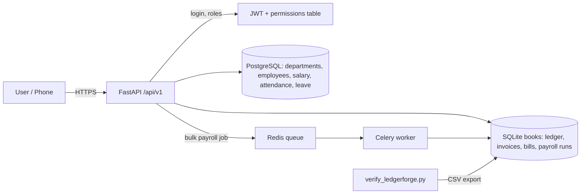

# LedgerForge: Payroll & Accounting Engine

A complete payroll and accounting backend for **Zenith Nova Technologies**. Built with FastAPI, PostgreSQL, SQLite (books), Redis/Celery, and Docker.

## Quick Start (Local)

```bash
# 1. Clone and enter
git clone https://github.com/your-org/ledgerforge.git
cd ledgerforge

# 2. Configure secrets (never commit .env)
cp .env.example .env
# Edit .env with real values:
#   LEDGERFORGE_SECRET_KEY=<python -c "import secrets; print(secrets.token_urlsafe(48))">
#   POSTGRES_PASSWORD=<strong password>
#   DEMO_PASSWORD=<demo user password>

# 3. Start everything (API, Postgres, Redis, Celery worker)
docker compose up --build

# 4. Open API docs
open http://localhost:8000/docs
```

**Demo logins** (password from `DEMO_PASSWORD` in `.env`):
| Role | Email |
|------|-------|
| Admin | sanjay.kumar@znova-demo.example |
| Admin | vijay.ramesh@znova-demo.example |
| HR | hemant.mathew@znova-demo.example |
| HR | kiran.krishnan@znova-demo.example |
| Employee | jatin.jayaraman@znova-demo.example |
| Employee | zaid.selvam@znova-demo.example |

---

## Architecture



**One payroll run:** attendance + leave → payroll engine → payroll run (draft, processed, approved, paid) → ledger entries → trial balance → P&L → balance sheet.

---

## Features

| Module | Description |
|--------|-------------|
| **Employees** | Departments, roles, salary structures with revision history, prorated mid-month joiners |
| **Attendance & Leave** | 150k+ attendance rows, 3.4k leave requests, loss-of-pay calc, holiday-aware |
| **Payroll Engine** | 7,340 payslips match official data exactly (0 mismatches) |
| **Payslips** | PDF generation, role-based access (owner, HR, Admin) |
| **Ledger** | Double-entry, immutable posted entries, reversals for corrections |
| **Invoicing** | Draft → Sent → Paid/Overdue, GST, payments, receivables reconciliation |
| **Vendor Bills** | Submit → Approve → Pay, duplicate detection, GST |
| **Payroll Runs** | Idempotent monthly runs, separation of duties (run ≠ approve), full audit trail |
| **Tax Engine** | Slabs & parameters as data, yearly regimes, marginal relief, rule change log |
| **Statutory Reports** | Monthly PF/ESI/TDS/PT remittance, employer share, CSV export |
| **Financial Reports** | Trial Balance, P&L, Balance Sheet (as-of date), contra assets |
| **Background Jobs** | 18-month bulk payroll via Celery, progress endpoint `/api/v1/jobs/{id}` |
| **Security** | scrypt hashes, 30-min JWT, roles (Admin/HR/Employee), deny-by-default |
| **Observability** | JSON logs, `/health` checks both DBs, request IDs, backup/restore scripts |

---

## API Reference

All endpoints under `/api/v1` except `/auth/login`, `/health`, `/openapi.json`.

### Authentication
```
POST   /auth/login           # Get JWT (form: username, password)
```

### Employees
```
GET    /employees                    # List (pagination, search, filter)
GET    /employees/{id}               # Get one
POST   /employees                    # Create (Admin/HR)
PATCH  /employees/{id}               # Update (Admin/HR)
DELETE /employees/{id}               # Set exit_date (Admin/HR)
GET    /employees/{id}/team          # Direct reports
```

### Salary
```
GET    /salary/structures            # List structures
POST   /salary/structures            # Create (Admin/HR)
GET    /salary/structures/{id}       # Get with revisions
POST   /salary/structures/{id}/revisions  # Add revision (Admin/HR)
GET    /salary/employee/{id}         # Salary on a date
```

### Attendance & Leave
```
GET    /attendance/summary/{emp_id}?month=2025-09
GET    /leave/requests               # List (filter by status, employee)
POST   /leave/requests               # Apply (Employee)
PATCH  /leave/requests/{id}/approve  # Approve (HR)
PATCH  /leave/requests/{id}/reject   # Reject (HR)
GET    /leave/balances/{emp_id}
```

### Payroll
```
GET    /payroll/runs                 # List runs
POST   /payroll/runs                 # Create run for month (HR)
POST   /payroll/runs/{id}/process    # Process (HR)
POST   /payroll/runs/{id}/approve    # Approve & post to ledger (Admin)
POST   /payroll/runs/{id}/pay        # Mark paid (Admin)
POST   /payroll/runs/{id}/reverse    # Reverse (Admin)
GET    /payslips/{run_id}/{emp_id}   # View (owner, HR, Admin)
GET    /payslips/{run_id}/{emp_id}/pdf  # Download PDF
```

### Jobs (Background Bulk Payroll)
```
POST   /jobs/payroll-process         # Start 18-month process (HR/Admin)
POST   /jobs/payroll-approve         # Start 18-month approve (Admin)
GET    /jobs                         # List jobs
GET    /jobs/{job_id}                # Progress: status, done/total, percent, result
```

### Invoicing & Bills
```
GET    /invoices                     # List
POST   /invoices                     # Create draft
POST   /invoices/{id}/send           # Send (posts receivable)
POST   /invoices/{id}/pay            # Record payment
GET    /bills                        # List vendor bills
POST   /bills                        # Submit bill
POST   /bills/{id}/approve           # Approve (posts expense + payable)
POST   /bills/{id}/pay               # Pay bill
```

### Reports
```
GET    /reports/trial-balance?from=2025-01-01&to=2025-12-31
GET    /reports/profit-and-loss?from=2025-01-01&to=2025-12-31
GET    /reports/balance-sheet?as_of=2026-09-30
GET    /reports/statutory-summary
GET    /reports/statutory/{kind}/{run_id}  # kind: pf, esi, tds, pt
```

### Exports
```
GET    /export/books                 # Download all books tables as ZIP (Admin)
GET    /export/payroll?from=2025-04&to=2026-09  # Incremental payroll export
```

### System
```
GET    /health                       # Checks both DBs, no auth
GET    /openapi.json                 # OpenAPI spec with examples
```

---

## Running Tests

```bash
# All tests (203 tests, ~3 min)
pytest -q

# With coverage
pytest --cov=app --cov-report=term-missing

# Specific areas
pytest tests/test_security.py tests/test_api_security.py -q
pytest tests/test_payroll_engine.py tests/test_payroll_rules.py -q
pytest tests/test_financials.py tests/test_statutory_reports.py -q
```

**Coverage:** 89% (203 tests pass)

---

## Verification (Official Checks)

```bash
# Export current data
python -c "from app.exporter import export_all; export_all('my_export')"

# Run 5 official integrity checks
python verify_ledgerforge.py checks --data my_export/
# Expected: 5/5 PASS
# 1. Every journal entry balances
# 2. Payroll equals ledger, every month
# 3. Receivables equal open invoices
# 4. Payroll employees exist
# 5. Nobody is paid after leaving
```

---

## Backup & Restore

```bash
# Backup (SQLite books + Postgres if pg_dump available)
python -m scripts.backup

# Verify restore
python -m scripts.restore_check backups/books_YYYYMMDD_HHMMSS.sqlite
# Expected: RESTORE PROVED
```

---

## Development (No Docker)

```bash
python -m venv .venv
# Windows: .venv\Scripts\activate
# Mac/Linux: source .venv/bin/activate
pip install -r requirements.txt
cp .env.example .env
# Edit .env with local values (SQLite for books, no Postgres needed for API)
python -m scripts.init_db
python -m scripts.load_official_books
python -m app.load_payroll
uvicorn app.main:app --reload
```

---

## Deployment (Production)

1. **Hosted PostgreSQL** (Neon, Supabase, Railway, or managed PG)
2. **Hosted Redis** (for Celery)
3. **Container host** (Fly.io, Railway, Render, Cloud Run, or VM)
4. Set all `.env` values as environment variables in the host
5. Deploy from `v1.0.0` tag
6. Run migrations: `alembic upgrade head`
7. Seed data: `python -m scripts.init_db && python -m scripts.load_official_books && python -m app.load_payroll`
8. Run smoke test: `python smoke_test.py https://your-live-url`

---

## Project Structure

```
app/
  main.py              # FastAPI app, routes, versioning, observability
  models.py            # SQLAlchemy models (PostgreSQL)
  models_payroll.py    # Payroll ORM models
  database.py          # Postgres engine/session
  books_db.py          # SQLite books layer (ledger, invoices, payroll runs)
  deps.py              # DB dependencies, auth
  permissions.py       # Role-permission matrix
  security.py          # JWT, password hashing
  observability.py     # JSON logs, /health middleware
  cache.py             # TTL cache for reports
  versioning.py        # /api/v1 prefix for all routers
  worker.py            # Celery app
  jobs.py              # Background job logic
  payroll_engine.py    # Core calculation (7 rules)
  payroll_rules.py     # Rule implementations
  payroll_posting.py   # Payroll → ledger
  payroll_runs.py      # Run lifecycle (draft→processed→approved→paid→reversed)
  payslip_service.py   # Payslip data & PDF
  ledger.py            # Journal entry CRUD + posting
  financials.py        # Trial balance, P&L, Balance sheet
  statutory_reports.py # PF/ESI/TDS/PT monthly
  tax_config.py        # Tax slabs/parameters as data
  exporter.py          # CSV export for verification
  routers/             # API routers (auth, employees, salary, payslips, jobs, reports, books, tax)
scripts/
  init_db.py           # Seed users, chart of accounts, vendors, tax rules
  load_official_books.py  # Load ledger, invoices, clients from CSV
  load_payroll.py      # Load payroll runs & items from CSV
  backup.py            # SQLite + pg_dump backup
  restore_check.py     # Verify restore integrity
  export_data.py       # Ad-hoc table export with date filters
  entrypoint.py        # Docker startup (validate secrets, seed once, run API)
tests/                 # 203 tests
seed/                  # 30 CSV files (official dataset)
```

---

## Release Notes

See [docs/RELEASE_NOTES.md](docs/RELEASE_NOTES.md)

---

## License

Internal use only — Zenith Nova Technologies.
## Connected browser workspace

Run `python start_server.py` from the project folder. The browser workspace at `/` includes navigation for Dashboard, Employees, Departments, Payroll, Payslips, Accounting, Reports, Vendor bills, Tax & rules, and Background jobs. The UI uses the authenticated `/api/v1` endpoints; permissions remain enforced by the API for every operation.


## Local data initialization

The startup script initializes missing database schemas and imports the local CSV data only when the target tables are empty. It does not reset populated tables. The employee/salary database reads from `data/` by default (`DATA_DIR` may override it). The books database reads the same folder through `LEDGERFORGE_DATA`.

- `scripts/load_data.py` loads departments, roles, employees, assignments, salary components, salary revisions, salary structures, attendance, leave types, holidays, leave requests, and leave balances into the employee/salary database.
- `scripts/load_official_books.py` loads the official ledger, invoices, clients, and tax rules into the books database if the journal is empty.
- `scripts/load_books_payroll.py` links the CSV payroll register and payroll items to the books database. It inserts missing records only and maps existing payroll journal/payment entries when available.
- `scripts/load_books_expenses.py` imports the expense/bill register and maps paid/unpaid source statuses to the API bill workflow while retaining ledger/payment entry links.

The demo login password for newly seeded demo users is `Demo@12345`. Existing user records are not reset automatically.
